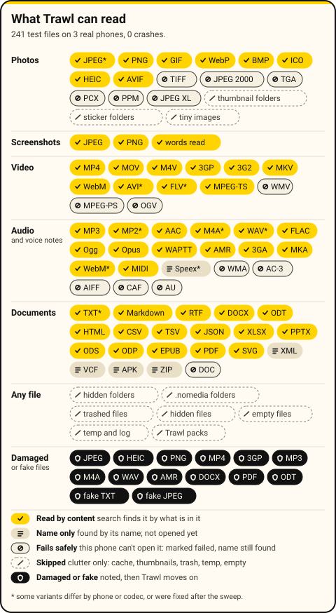

<div align="center">

<a href="https://trawlsearch.com">
  
</a>

<h1>Trawl</h1>

<p>
  <strong>Private, offline search across your photos, documents, screenshots, voice notes, and videos — by meaning, OCR, or speech.</strong>
</p>

<p>
  <a href="LICENSE"></a>
  <a href="https://github.com/Crane-AI-Labs/trawl/releases/tag/v1.2.0"></a>
  <a href="https://github.com/Crane-AI-Labs/trawl/releases/tag/desktop-1.1.0"></a>
  <a href="PRIVACY.md"></a>
  <a href="https://trawlsearch.com"></a>
  <a href="https://app.trawlsearch.com"></a>
</p>

<p>
  <a href="#download">Download</a> &nbsp;·&nbsp;
  <a href="#what-trawl-finds">Features</a> &nbsp;·&nbsp;
  <a href="#verifiable-privacy">Why Offline</a> &nbsp;·&nbsp;
  <a href="#benchmarks">Benchmarks</a> &nbsp;·&nbsp;
  <a href="#build-from-source">Build from Source</a>
</p>

</div>

<br />

https://github.com/user-attachments/assets/ccb3d680-b544-4a83-812f-eb773df30507

<br />

## What Trawl Finds

Describe what is *inside* a file — even when its filename is `IMG_4821.jpg`, `Scan_004.pdf`, or `PTT-20260412-WA0008.opus`:

| Capability | Example Queries | How It Works Locally |
|---|---|---|
| **Visual & Scene Search** | `"happy man singing"`, `"sunset by the water"`, `"the dog at the lake"` | On-device multimodal image & video-frame embeddings — no cloud tagging. |
| **Text Inside Images & PDFs (OCR)** | `"wifi password"`, `"receipt from hardware shop"`, `"50000"` *(matches `50k` / `50,000`)* | Reads screenshots, photographed receipts, scanned PDFs, Office docs & `.xls` sheets. |
| **Spoken Words in Audio & Video** | `"meeting about the budget"`, `"school fees due Friday"` | On-device speech transcription in **English** plus optional offline packs for **5 East African languages**: Luganda, Swahili, Runyankole, Acholi, and Lusoga *(beta)*. |
| **Find Similar** | Click **Find similar** on any photo or document | Ranks visually or semantically related files across your local index in milliseconds. |
| **Fast Exact & Multilingual Text** | Any word, ID, invoice number, or phrase | Local SQLite FTS5 across English, Luganda, Swahili, French, Arabic, Portuguese, Kinyarwanda, Hausa, Yoruba, Amharic, and more. |

<details>
<summary><strong>Supported file formats (241-file real-device sweep)</strong></summary>
<br />
<p align="center">
  
</p>
<p align="center"><em>Damaged or malformed files are logged and skipped without crashing. Clutter folders, thumbnails, and chat databases stay out of your index.</em></p>
</details>

---

## Download

All desktop and mobile releases are free, open source, and published directly on [GitHub Releases](https://github.com/Crane-AI-Labs/trawl/releases) with `SHA256SUMS`.

| Platform | Download | Notes |
|---|---|---|
| **macOS** *(Apple Silicon, 13+)* | [`Trawl-1.1.0-arm64.dmg`](https://github.com/Crane-AI-Labs/trawl/releases/download/desktop-1.1.0/Trawl-1.1.0-arm64.dmg) *(232 MiB)* | Unsigned release — right-click → **Open** on first launch. |
| **Windows** *(64-bit x64)* | [`Trawl-1.1.0.msi`](https://github.com/Crane-AI-Labs/trawl/releases/download/desktop-1.1.0/Trawl-1.1.0.msi) *(223 MiB)* | Unsigned release — SmartScreen → **More info** → **Run anyway**. |
| **Linux** *(Debian/Ubuntu x64)* | [`trawl_1.1.0_amd64.deb`](https://github.com/Crane-AI-Labs/trawl/releases/download/desktop-1.1.0/trawl_1.1.0_amd64.deb) *(222 MiB)* | `sudo apt install ./trawl_1.1.0_amd64.deb` (`ffmpeg` for video). |
| **Android** *(64-bit, Android 11+)* | [`trawl-1.2.0.apk`](https://github.com/Crane-AI-Labs/trawl/releases/download/v1.2.0/trawl-1.2.0.apk) *(46 MiB)* | Full semantic, OCR, video & voice-note search. |
| **Android Go** *(32-bit / 2 GB RAM)* | [`trawl-go-1.2.0.apk`](https://github.com/Crane-AI-Labs/trawl/releases/download/v1.2.0/trawl-go-1.2.0.apk) *(20 MiB)* | Lightweight words + OCR edition — no model download needed. |
| **Web Demo** *(Any modern browser)* | [**app.trawlsearch.com**](https://app.trawlsearch.com) | Runs locally in WebAssembly + OPFS. Zero file uploads. |
| **iPhone (iOS)** | *In progress* | Native on-device iOS app under active development (`PrivacyInfo.xcprivacy` with "Data Not Collected"). |

### Offline Model Bundles & East African Speech Packs

All AI weights are optional offline zips published in [**`models-v1`**](https://github.com/Crane-AI-Labs/trawl/releases/tag/models-v1) — drop a zip into your `Downloads` folder and Trawl verifies its signature and SHA-256 checksums locally before loading:

- **Core search bundles:**
  - `trawl-models.zip` *(670 MB)* — Desktop & Android devices with 3 GB+ RAM.
  - `trawl-models-lite.zip` *(304 MB)* — Android devices with 2 GB RAM.
- **Offline East African speech packs (~101 MB each):**
  - Luganda (`trawl-speech-lg.zip`), Swahili (`trawl-speech-sw.zip`), Runyankole (`trawl-speech-nyn.zip`), Acholi (`trawl-speech-ach.zip`), and Lusoga beta (`trawl-speech-xog.zip`).

<details>
<summary><strong>Official Android signing certificate (SHA-256)</strong></summary>

```text
3d056763b58093e91006f00b44d98d47bfe5f26140be6105598363e670708d80  (CN=Trawl, O=Crane AI Labs, C=UG)
```

</details>

---

## Verifiable Privacy

Trawl doesn't ask you to trust a privacy policy — it is built so you can verify it yourself ([`PRIVACY.md`](PRIVACY.md)):

- **Zero internet permission on Android:** `trawl-1.2.0.apk` and `trawl-go-1.2.0.apk` declare **zero `android.permission.INTERNET`**. Verify any APK yourself:
  ```bash
  aapt dump permissions trawl-1.2.0.apk | grep INTERNET || echo "0 network permissions"
  ```
- **100% on-device storage & indexing:** Your index lives exclusively in local SQLite/FTS5 + quantized embedding vectors on your device. No account, no telemetry, no analytics, no ads, and Trawl never modifies or deletes your files.
- **Zero-upload Web Demo with WebCrypto Vault Lock:** [`app.trawlsearch.com`](https://app.trawlsearch.com) indexes selected folders entirely inside your browser (WebAssembly + OPFS, strict `connect-src 'self'` CSP), encrypting local file indexes with client-side WebCrypto (`PBKDF2` + `AES-256-GCM`).

---

## Benchmarks

Measured on real consumer hardware with zero cloud assistance. Full methodology and device traces live at [trawlsearch.com/how-we-measured.html](https://trawlsearch.com/how-we-measured.html).

| Platform & Device | Benchmark | Trawl | Built-in OS Search |
|---|---|---:|---:|
| **macOS** *(Apple M5)* | Opaque-filename corpus *(semantic, OCR, visual, speech)* | **24 / 24** | 6 / 24 *(Spotlight)* |
| **macOS** *(Apple M5)* | Exact document keyword queries *(fair baseline)* | **6 / 6** | 6 / 6 *(Spotlight)* |
| **Android** *(Galaxy A06 & TECNO KN4)* | Semantic, OCR & spoken-word queries | **5 / 5** | 0 / 5 *(Built-in)* |
| **Android** *(Galaxy A06, 4 GB RAM)* | Scroll smoothness (heavy frame jank) | **6.1%** *(4.1× fewer stutters)* | 25.3% *(Samsung Gallery)* |

---

## Build from Source

Requires **JDK 17+** (Android SDK platform 36 for Android builds). See [`docs/ARCHITECTURE.md`](docs/ARCHITECTURE.md) for system internals.

```bash
# Desktop (macOS / Windows / Linux)
cd desktop && ../gradlew run                         # launch Desktop app locally
cd desktop && ../gradlew test                        # run Desktop test suite

# Android (Full 64-bit & Go 32-bit)
./gradlew :app:assembleGoDebug                       # build Trawl Go (no native AARs required)
./gradlew :app:assembleFullDebug                     # build Full edition (after fetching native AARs)
./gradlew :app:testFullDebugUnitTest :app:testGoDebugUnitTest
```

<details>
<summary><strong>Native AARs, model bundles, and release signing</strong></summary>

<br />

- **Native libraries (`app/libs/`, required for the `full` Android flavor):**
  - Fetch `sherpa-onnx` AAR: `scripts/fetch-asr.sh`
  - Build `onnxruntime-slim` AAR: `TRAWL_BUILD_SSH=user@host scripts/ort-slim/build.sh` (see [`scripts/ort-slim/README.md`](scripts/ort-slim/README.md))
- **Model bundles:** Place source weights in `bench-data/` and run `scripts/pack-bundle.sh` (`LITE=1` for 2 GB bundle). Local unsigned testing builds accept unsigned bundles with `-PallowUnsignedModels=true`.
- **Signed Android releases:** Generate a local keystore via `scripts/make-signing-key.sh` (written to `~/.gradle/gradle.properties`, never committed), then run:
  ```bash
  ./gradlew :app:assembleFullRelease :app:assembleGoRelease -PtrawlPublish=true
  ```
- **Desktop installers:** Run `packageDmg` (macOS), `packageMsi` (Windows), or `packageDeb` (Linux) from `desktop/`.

</details>

<details>
<summary><strong>Open models, libraries & credits</strong></summary>

<br />

| Model / Library | Role | License |
|---|---|---|
| [EmbeddingGemma 2](https://huggingface.co/google/embeddinggemma-2) *(Google)* | Semantic search over text & images | Apache-2.0 |
| [TinyCLIP](https://github.com/microsoft/Cream) *(Microsoft)* | Fast photo visual search while indexing | MIT |
| [Parakeet-TDT-CTC-110M](https://huggingface.co/nvidia/parakeet-tdt_ctc-110m) *(NVIDIA)* | On-device English speech transcription | CC-BY-4.0 |
| [nsfw-image-detection-384](https://huggingface.co/Marqo/nsfw-image-detection-384) *(Marqo)* | Optional private-preview blur | Apache-2.0 |
| Silero VAD, CED-mini, Moonshine tiny | Voice activity, sound labels & speech | MIT / Apache-2.0 |
| LiteRT-LM, sherpa-onnx, ONNX Runtime, PdfBox-Android, Atkinson Hyperlegible | Runtime, OCR/PDF & typography | See [`THIRD_PARTY_NOTICES.md`](THIRD_PARTY_NOTICES.md) |

Inspired in design philosophy by [DigUp](https://github.com/ARahim3/DigUp) (MIT); zero code copied.

</details>

---

## License

Copyright 2026 **Crane AI Labs**. Open source under the [**Apache License, Version 2.0**](LICENSE) — see [`NOTICE`](NOTICE) and [`THIRD_PARTY_NOTICES.md`](THIRD_PARTY_NOTICES.md) for bundled model and library attributions.
