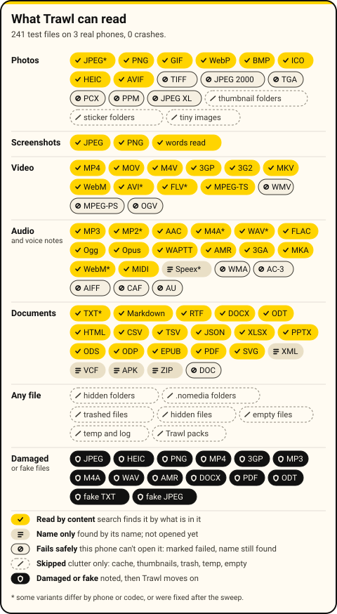

# Trawl

**Trawl by Crane AI Labs** is an Android app that finds the photos, screenshots, documents, videos and voice notes on your phone when you describe what is in them. It runs entirely on the phone: the app has no internet permission, needs no account and shows no ads.

[Website](https://trawl.craneailabs.com/) | [Check the privacy claims yourself](PRIVACY.md) | [How we measured](https://trawl.craneailabs.com/how-we-measured.html) | [Releases](https://github.com/Crane-AI-Labs/trawl/releases)

Type "receipt from the hardware shop", "the dog at the lake" or "meeting about the budget" and Trawl brings up the file.
It works fully offline: it reads the files already on your phone, builds a search index on the phone, and never sends anything anywhere.

Made by [Crane AI Labs](https://github.com/Crane-AI-Labs). Android 11 or newer. How it works: [docs/ARCHITECTURE.md](docs/ARCHITECTURE.md).

## Download

Get the app from [**Releases**](https://github.com/Crane-AI-Labs/trawl/releases/latest): `trawl-<version>.apk`. Open it on your
phone and allow the install (it is an app outside Google Play, so Android asks once).

Trawl needs its search models, one file downloaded once. Inside the app, **Get the models** fetches the right one for your phone.
To download on another device and copy it over, the files are on the `models-v1` release:

| File | For |
|---|---|
| `trawl-models.zip` (about 670 MB) | phones with 3 GB of memory or more |
| `trawl-models-lite.zip` (about 304 MB) | phones with 2 GB of memory |

Copy the zip into your phone's Downloads folder and open Trawl: it finds the file and checks its signature and checksums before using it.

Trawl needs Android 11 or newer on a 64-bit phone. For 32-bit Android Go phones (many itel models, some 2 GB phones) there is
**Trawl Go**, `trawl-go-<version>.apk` on the same release (about 21 MB). It needs no models: it finds files by their names, the
words in documents and the words in photos and screenshots, but it doesn't search by meaning or listen to recordings.

## Desktop developer preview

A Windows, Mac and Linux version is available as a **developer preview** on the
[`desktop-preview-1.0.2`](https://github.com/Crane-AI-Labs/trawl/releases/tag/desktop-preview-1.0.2) release. The installers are
**unsigned**: on a Mac right-click the app and choose Open; on Windows SmartScreen shows "More info", then "Run anyway"; on Linux run
`sudo apt install ./trawl_1.0.2_amd64.deb` (video needs `ffmpeg`). The desktop app makes no network connections either; the release
notes say how that was tested.

## What it reads

Photos and screenshots (and the words in them), video (what you see, the words on screen, and what is said), audio and voice
notes, PDFs and common documents. Files it cannot open yet are still found by name. Damaged or fake files are noted and skipped,
never a crash. This chart comes from a sweep of 241 test files on real phones:

<p align="center"></p>

## Languages

Search works best in **English**, which is the first quality gate. Other languages work in varying degrees and are improving:
Luganda, Swahili, Runyankole, Acholi, Ateso, Lugbara, Kinyarwanda, French, Portuguese, Arabic, Amharic, Hausa, Yoruba, Somali, Zulu and more.
Exact-word search works in any language. Spoken words are transcribed in English only for now.

## Privacy

- Nothing leaves your phone. There is no internet permission, so the app could not send anything even if it tried.
- No ads, no analytics, no account.
- The index lives in the app's private storage on the phone. Uninstalling the app deletes it.
- If the app crashes, it offers a problem report with no file names, searches or text from your files. You read it first, and it is sent only when you press Send in your own email app.
- Trawl asks for **All files access** so it can read the files it searches. It never changes or deletes them.

## Credits and licences

Inspired by [DigUp](https://github.com/ARahim3/DigUp) (MIT): design ideas only; no code was copied.

Trawl is built on open models and libraries. Each one's version, licence and required notice is in
[THIRD_PARTY_NOTICES.md](THIRD_PARTY_NOTICES.md), and in the app under Settings, Licences and credits. The models:

| Model | Used for | Licence |
|---|---|---|
| [EmbeddingGemma 2](https://huggingface.co/google/embeddinggemma-2), Google | meaning search over text and images | Apache-2.0 |
| [TinyCLIP](https://github.com/microsoft/Cream), Microsoft | Quick look: fast photo results while indexing | MIT |
| [Parakeet-TDT-CTC-110M](https://huggingface.co/nvidia/parakeet-tdt_ctc-110m), NVIDIA | English speech to text | CC-BY-4.0 (attribution) |
| [nsfw-image-detection-384](https://huggingface.co/Marqo/nsfw-image-detection-384), Marqo | optional blur of private-looking previews | Apache-2.0 |
| Silero VAD, CED-mini, Moonshine tiny | speech detection, sound labels, optional speech model | MIT, Apache-2.0, MIT |

Libraries: [LiteRT-LM](https://github.com/google-ai-edge/LiteRT-LM), [sherpa-onnx](https://github.com/k2-fsa/sherpa-onnx),
[ONNX Runtime](https://github.com/microsoft/onnxruntime), Google ML Kit text recognition (Google's terms),
[PdfBox-Android](https://github.com/TomRoush/PdfBox-Android), Coil, AndroidX and Jetpack Compose, Kotlin.
The font is Atkinson Hyperlegible (SIL OFL 1.1).

## Build from source

You need JDK 17 and the Android SDK (platform 36). The build uses Gradle (`./gradlew`).

```
./gradlew :app:assembleDebug            # a debug build
./gradlew :app:testFullDebugUnitTest :app:testGoDebugUnitTest   # the unit tests (both editions)
./gradlew :app:assembleRelease          # a release build (debug-signed unless you set up a key, below)
./gradlew :app:assembleGoRelease        # Trawl Go, the 32-bit words-only edition (no native model libraries)
```

The app has two editions, as product flavors over one code base: `full` (Trawl, arm64-v8a) and `go` (Trawl Go, armeabi-v7a,
package `com.craneai.findr.go`). `src/main` is shared; `src/full` and `src/go` hold what differs. The plain task names
(`assembleRelease`, `assembleDebug`) build the full edition.

Two native libraries are not in the repository (they are large) and go in `app/libs/`. **A fresh clone does not build the full
edition until both AARs are there**:

- **sherpa-onnx** AAR (speech, voice detection, sound labels): `scripts/fetch-asr.sh` fetches the pinned version.
- **onnxruntime-slim** AAR (an ONNX Runtime with only the operators Quick look and private-preview blur use, 9 MB smaller),
  built from source by `scripts/ort-slim/build.sh` on a Linux machine you can reach over ssh: set `TRAWL_BUILD_SSH=user@host`
  (see `scripts/ort-slim/README.md`). The script writes the finished AAR to `app/libs/`.

**Models.** The models are not in the repository either, and live under the ignored folder `bench-data/`.
`scripts/pack-bundle.sh` builds the one-file bundle the app installs (`LITE=1 scripts/pack-bundle.sh` for the lite one). A release
app only accepts bundles signed with a key whose public half is compiled into `engine/SignedBundle.kt`. The signing key is not
in this repository. To use your own models, make your own key, put its public half in `engine/SignedBundle.kt`, and sign by
setting `TRAWL_SIGN_SSH` (an ssh target with the Azure CLI logged in) and `TRAWL_VAULT` (the Key Vault that holds the key).
Neither has a default, and `NO_SIGN=1` writes an unsigned bundle. For local testing only, build with
`-PallowUnsignedModels=true`.

**Signing a release.** `scripts/make-signing-key.sh` creates a publishing key on your machine and writes its location to
`~/.gradle/gradle.properties`; the key and passwords never enter the repository. Then
`./gradlew :app:assembleRelease -PtrawlPublish=true` builds a release signed with it (and refuses to fall back to a debug key).
Without `-PtrawlPublish=true` every build stays debug-signed, so test phones keep upgrading in place.
`scripts/release.sh <version>` does the whole sequence, builds both model bundles (it needs `TRAWL_SIGN_SSH` and `TRAWL_VAULT`,
or `--no-models`), writes the release notes and prints the `gh release create` commands. It never publishes anything itself.

**Phones.** The adb helpers (`scripts/phone-lock.sh` and friends) take the phone from `ANDROID_SERIAL`. Your own phone list, and
any phone that must not be locked without an explicit go, goes in an ignored file `scripts/phones.local`; copy
`scripts/phones.local.example`.

## Licence

Trawl is open source under the **Apache License, Version 2.0**: see [LICENSE](LICENSE), and [NOTICE](NOTICE) for the notices that
travel with it. Copyright 2026 Crane AI Labs. The models and libraries it uses keep their own licences, listed in
[THIRD_PARTY_NOTICES.md](THIRD_PARTY_NOTICES.md). The Android app uses Google ML Kit for text recognition, a proprietary Google
library linked at build time; Apache-2.0 has no copyleft, so that sits beside this licence without a conflict.
